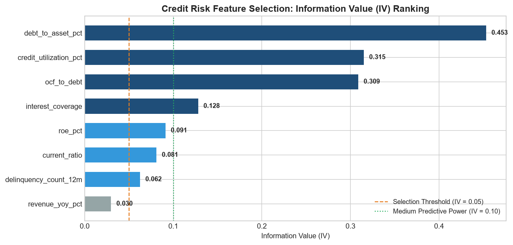
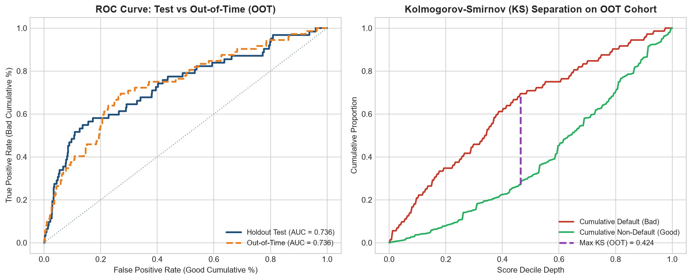
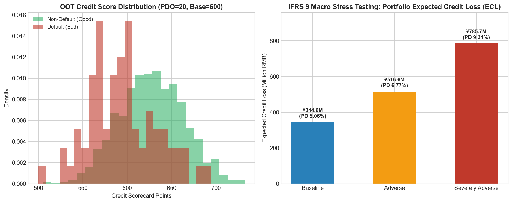

# 商业银行信用风险评分卡与 IFRS 9 宏观压力测试系统

> **Commercial Bank Credit Risk Scorecard, WOE/IV Feature Engineering & IFRS 9 ECL Stress Testing**  
> 结合 **商业银行业务与经营、财务管理与计量经济学** 实践，面向城商行/券商风险管理与金融数据分析岗，完整实现 **WOE/IV 特征分箱 → 逻辑回归标准评分卡（PDO=20）→ 跨时间（OOT）AUC/KS/PSI 验证 → 宏观压力测试与预期信用损失（ECL）测算**。


---

## 一、业务与建模框架

1. **财务与信用多维特征工程（`src/woe_iv_engine.py`）**
   - 覆盖企业/小微授信核心财务比率与履约指标：资产负债率（`debt_to_asset_pct`）、授信使用率（`credit_utilization_pct`）、经营现金流债务覆盖率（`ocf_to_debt`）、利息保障倍数（`interest_coverage`）、净资产收益率（`roe_pct`）、流动比率（`current_ratio`）与近 12 个月逾期次数（`delinquency_count_12m`）。
   - 执行分箱、WOE 编码与信息价值（IV）筛选（剔除 `IV < 0.05` 弱预测特征）。
2. **标准逻辑回归评分卡刻度映射（`src/scorecard_model.py`）**
   - 采用 L2 正则化逻辑回归估计 12 个月违约概率（PD），并按银行业通用刻度公式（基准分 `600`，基准好坏比 `15:1`，`PDO = 20`）映射为可解释信用评分。
3. **跨时间（OOT）模型验证与稳定性监控**
   - 对比 Holdout Test 与 Out-of-Time（OOT）样本的 **ROC-AUC**、**Gini**、**KS 分离度**、**Top-20% 高风险组违约捕获率** 及 **群体稳定性指标（PSI）**。
4. **IFRS 9 宏观压力测试（`ECL = PD × LGD × EAD`）**
   - 针对 ¥150 亿元模拟对公/小微贷款组合，构建 **基准 / 轻度压力（+100bps 利率冲击 & -8% 营收冲击）/ 重度压力（+200bps & -18% 营收冲击）** 三套情景，量化组合平均 PD 迁徙与拨备资本缓冲需求。

---

## 二、核心验证与压力测试结果

| 验证指标 | Holdout Test | Out-of-Time (OOT) | 行业参考基准 |
| :--- | :---: | :---: | :---: |
| **ROC-AUC** | 0.7355 | **0.7362** | > 0.72（稳健无过拟合） |
| **KS 分离度** | 0.4121 | **0.4241** | > 0.35（强风险区分） |
| **Gini 系数** | 0.4710 | **0.4724** | > 0.40 |
| **PSI 群体稳定性** | — | **0.0318** | < 0.10（高度稳定） |
| **Top-20% 违约捕获率** | — | **47.2%** | 有效识别头部高风险敞口 |

### IFRS 9 预期信用损失（ECL）压力测试汇总（组合 EAD = 150.0 亿元）

| 宏观压力情景 | 组合平均 PD | 假设 LGD | 预期信用损失 ECL (百万元) | 损失率 (bps) |
| :--- | :---: | :---: | :---: | :---: |
| Baseline（基准情景） | 5.06% | 45.0% | **344.62** | 229.7 bps |
| Adverse（+100bps / -8% 营收） | 6.77% | 50.0% | **516.60** | 344.4 bps |
| Severely Adverse（+200bps / -18% 营收） | 9.31% | 55.0% | **785.69** | 523.7 bps |

---

## 三、可视化图表







---

## 四、快速运行

```bash
pip install -r requirements.txt
python -m src.scorecard_model
```

完整验证报告自动输出至：[reports/risk_model_validation_report.md](reports/risk_model_validation_report.md)。
